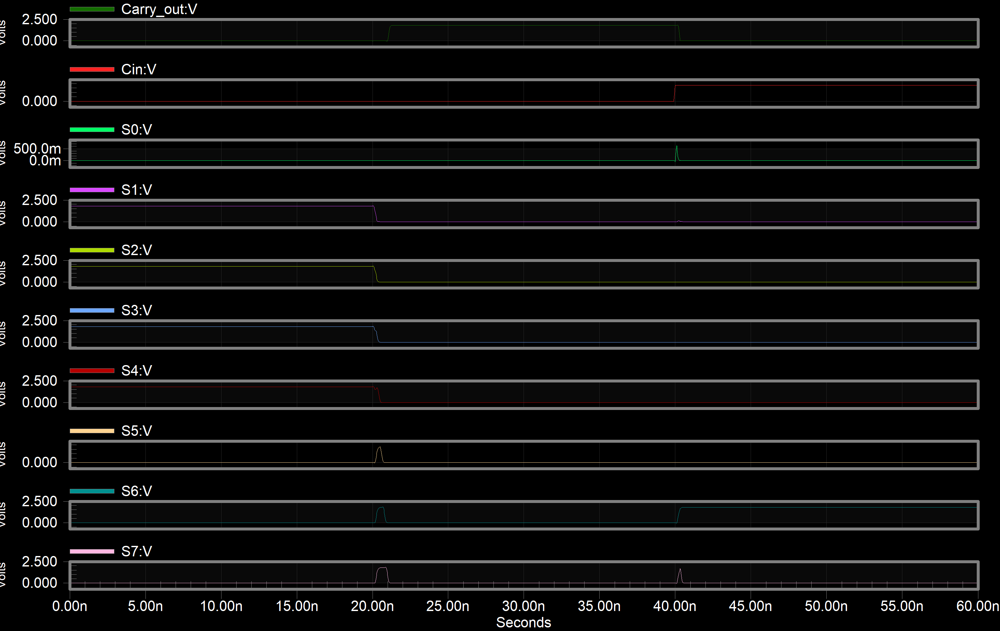
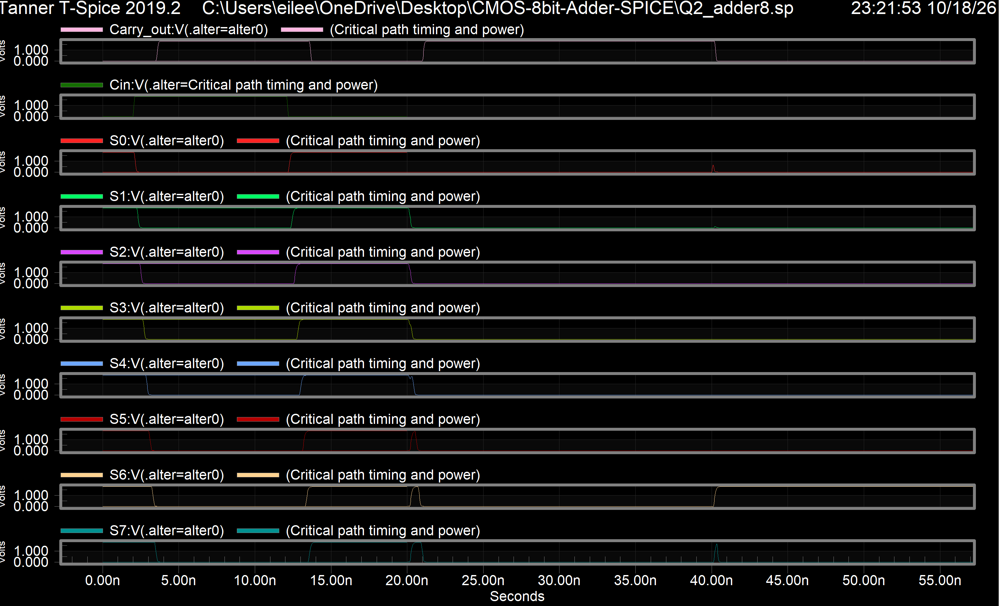

# 8-bit Ripple Carry Adder (CMOS, 180nm)

This is the second part of a simulation project I did for the Microelectronic / Digital Circuits course during my bachelor's. The first part was a single full adder cell, which is in its own repo:
[cmos-full-adder-spice](https://github.com/Eileenseyfipuor/cmos-full-adder-spice)

Here I took that cell and chained eight of them together to make an 8-bit ripple carry adder. The cell design and the transistor sizing are explained in the first repo, so I don't repeat them here.

Simulated with Tanner T-Spice, 1.8V supply, 180nm process.

## Files

- `Q2_adder8.sp` - the netlist (cell definitions + 8-bit adder + both simulations)
- `Q2_functional_only.sp` - just the functional test, so the waveforms don't overlap
- `results/` - waveform screenshots and the measurement output from T-Spice

## How it's built

The `fa` subcircuit is the full adder from part 1 (34 transistors). `add8` connects eight of them so the carry out of each bit goes into the carry in of the next one:

```
Cin -> FA0 -> FA1 -> FA2 -> FA3 -> FA4 -> FA5 -> FA6 -> FA7 -> Cout
        |      |      |      |      |      |      |      |
        S0     S1     S2     S3     S4     S5     S6     S7
```

272 transistors in total. Every output has a 10fF load.

## Simulation 1: does it add correctly?

I applied three input vectors, 20ns each:

| Time | A | B | Cin | Expected Sum | Expected Cout |
|---|---|---|---|---|---|
| 0-20ns | 0x0F | 0x0F | 0 | 0x1E | 0 |
| 20-40ns | 0xFF | 0x01 | 0 | 0x00 | 1 |
| 40-60ns | 0x33 | 0x0C | 1 | 0x40 | 0 |

The second one is the interesting case because the carry from bit 0 has to go all the way through to Cout.



All outputs match. The small spikes on some of the sum bits right after the inputs change are glitches: a sum bit shows the wrong value for a moment until the carry reaches it. This is normal for a ripple carry adder.

## Simulation 2: critical path

The slowest path in a ripple carry adder is the carry chain. To make the carry travel through all eight cells I set A = 0xFF and B = 0x00. That way A xor B = 1 in every bit, so no bit generates or kills the carry, they all just pass it along. Then I toggled Cin and measured how long it takes to reach Cout.



You can see the carry moving through the chain in the plot. When Cin goes high at 2ns, S0 drops first, then S1, S2 and so on, and Cout changes last.

Measured values (from `results/Q2_adder8.measure`):

| | Cin -> Cout |
|---|---|
| tPLH | 1.541 ns |
| tPHL | 1.501 ns |
| tP | 1.521 ns |
| tr | 133.8 ps |
| tf | 103.0 ps |
| Average power | 86.3 uW |

That's about 190ps per bit. In part 1 the carry delay of one cell on its own was 147.6ps, so I expected something closer to 8 x 148 = 1.2ns. It came out higher because inside the chain each cell is driven by the previous cell's output, which is slower than the ideal 100ps edges from the voltage sources in part 1. Each internal carry also has to drive the inputs of the next cell. On top of that, the part 1 measurement sent the carry through the A.B inputs of the AOI gate, while here it goes through the Cin.(A xor B) inputs.

The main point is that the delay grows with every bit you add. That's the big weakness of ripple carry and the reason faster designs like carry-lookahead exist.

## Running it

Open `Q2_adder8.sp` in T-Spice and run. Both simulations are in one file using `.alter`, so the waveform viewer draws them on top of each other for the first 20ns. After 20ns only the functional simulation is shown.

The netlist includes `mosistsmc180.lib`, the TSMC 180nm models we got through the university. That file is licensed so I didn't upload it. If you don't have it, the free 180nm model from [PTM](https://ptm.asu.edu/) should work (the netlist expects model names `NMOS` and `PMOS`). The numbers will be a bit different with it, but the circuit behaves the same way.

All transistor sizes use `.option scale=90n`, so `L=2` means 0.18um.
